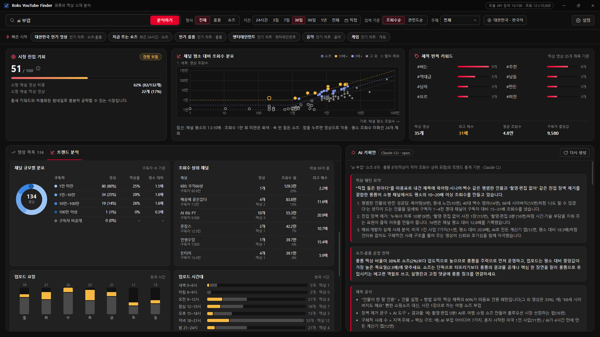

# Boks YouTube Finder

유튜브에서 **채널 평소 조회수보다 크게 터진(떡상) 영상**을 찾아 시장을 분석하고, PC에 설치된 **Claude CLI / Codex CLI**로 바로 만들 수 있는 기획안을 제안하는 데스크톱 앱입니다.
(Electron · YouTube Data API v3 · Claude/Codex CLI — 별도 LLM API 요금 없음)



## 주요 기능

- **빠른 시작 / 키워드 검색**: 키워드 없이 인기 차트(검색 할당량 0회)로 바로 보거나, 키워드·형식(쇼츠/롱폼)·기간·국가·언어·주제로 검색합니다.
- **떡상 판정**: 조회수 1만 회 이상이면서 `조회수 ÷ 채널 평소 조회수(같은 형식 최근 영상 중앙값) ≥ 3배`. 평소 조회수를 못 구하면 구독자 대비 배수로 추정 표시합니다.
- **한 화면 대시보드**: 시장 진입 기회 지수, 떡상 산점도, 제목 키워드 TOP 8, 영상 목록(필터·정렬·태그 복사), 트렌드 분석(길이·요일·시간대·제목 패턴·채널 집중도).
- **관련성 필터**: 해시태그 도배·다른 언어·키워드 무관 영상과 종교 영상(기본 제외, 글자 기반이라 100% 정확하지 않음)을 분석에서 뺍니다.
- **AI 기획안**: [기획안 생성]을 누를 때만 실행합니다. 설정에서 엔진(Claude/Codex)과 **모델·추론 수준**을 고를 수 있고, 목록은 설정을 열 때마다 설치된 CLI에서 새로 받습니다.
- **할당량 절약**: 같은 조건 검색 결과 재사용(기본 1시간), 채널 평소 조회수 캐시(기본 24시간), API 키별 오늘 사용량 표시와 한도 초과 전 차단.

## 시작하기

필요한 것
- [Node.js](https://nodejs.org/) 18 이상
- YouTube Data API v3 키 ([Google Cloud Console](https://console.cloud.google.com/apis/library/youtube.googleapis.com)에서 무료 발급)
- AI 기획안을 쓰려면 Claude CLI(`npm install -g @anthropic-ai/claude-code`) 또는 Codex CLI(npm 설치 또는 Codex 데스크톱 앱). 설정의 [자동 찾기]로 찾습니다.

```bash
git clone https://github.com/boksajang/boks-youtube-finder.git
cd boks-youtube-finder
npm install
npm start
```

처음 실행하면 [설정]에서 API 키를 넣고 [키 확인] → [저장]을 누르세요.

## YouTube API 사용량

- 기본 할당량: 검색 하루 100회 · 조회 하루 10,000 유닛(증설받았다면 [설정] → API 사용 한도에서 변경)
- 인기 차트 빠른 시작: 검색 0회 + 조회 약 100~300 유닛
- 키워드 검색 1회: 검색 1~6회(형식·보충 여부에 따라) + 조회 약 5~300 유닛

## 데이터와 보안

- 모든 데이터(설정·캐시·사용량·Electron 캐시)는 `app-data/` 폴더에만 저장합니다. 개발 실행과 Windows 설치판은 앱 폴더 안, macOS·Linux 설치판은 앱 폴더에 쓸 수 없어 `~/Library/Application Support/Boks YouTube Finder/app-data`(macOS) · `~/.config/Boks YouTube Finder/app-data`(Linux)입니다. API 키는 OS 보호 저장소(safeStorage)로 암호화합니다.
- AI CLI에는 프롬프트를 stdin으로 넘기고 도구·셸·웹 검색을 끈 채, 비어 있는 전용 작업 폴더(`app-data/ai-workspace/`)에서 실행합니다.

## 라이선스

MIT License © 2026 복사장 (Boksajang)
